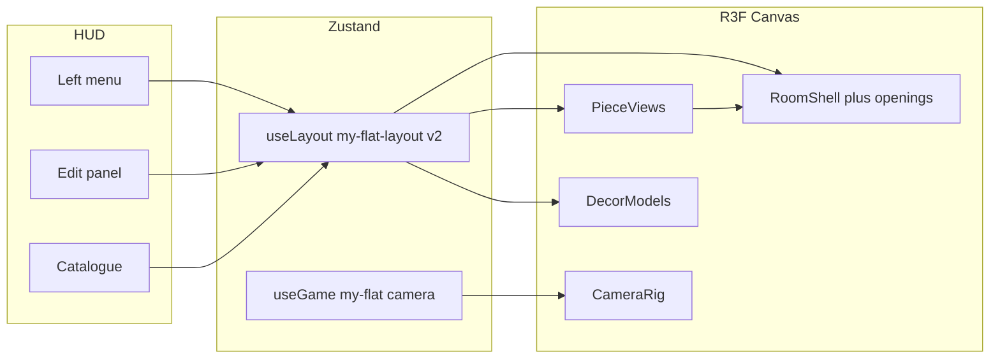
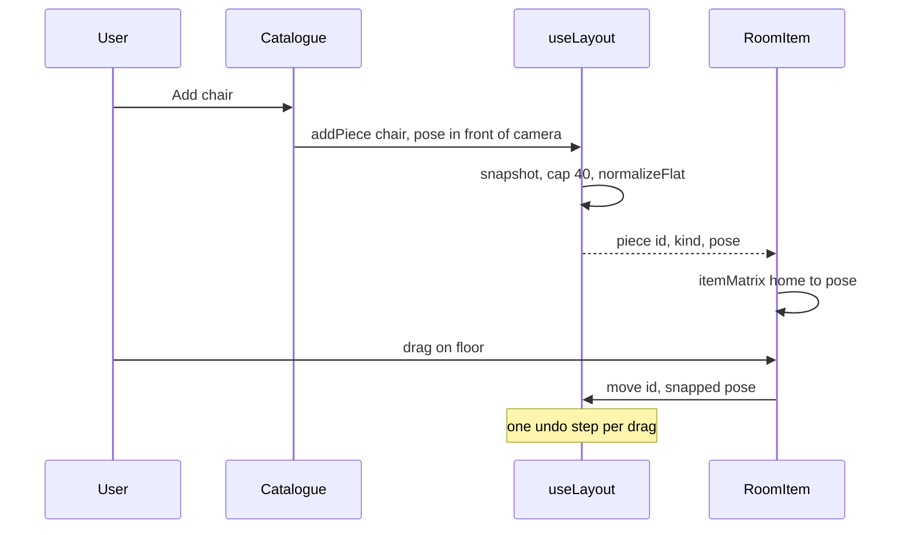
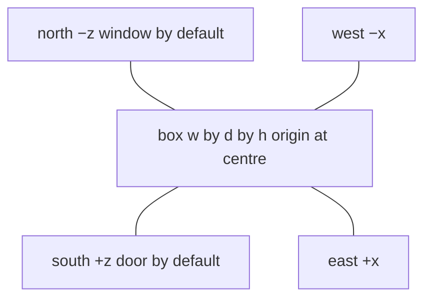

# My Flat — furniture placement v1

| | |
| --- | --- |
| Author | TBD |
| Date | 2026-11-08 |
| Status | Draft |
| Product | My Flat, a 清水樓 bare shell unit in the browser |
| Repo | `my flat` (fork of My Room; cutover commit `7e832de` on `main`) |
| Live | https://iravan.github.io/my-flat/ via `.github/workflows/pages.yml` |

This is a plan for changing the existing Next.js app. It is not a rewrite, and it does not add a backend, a physics engine, or a floor-plan kernel.

---

## Overview

My Flat is a placement tool for a real flat. The default layout is a 清水樓 (`web/lib/flat-plan.ts` `shimizu()`): the bare shell handed over by the Hong Kong Housing Authority, 4–5 person 構件式單位, ~35.9 m² internal floor area (≈386 sq ft), 6.9 m wide-frontage × 5.2 m deep, ceiling 2.55 m. The service strip by the front door holds the kitchen (walled), the entry run, the bath (walled) and a 1 m washer niche open to the room; the rest is one undivided living space. The view wall has two windows with solid wall between them, so a bedroom can be partitioned later and still have a window. Corridor-side kitchen and bath windows, and a closed front-door leaf. The user adds furniture from a catalogue, drags and rotates it, and walks the result at eye height. Layout stays on this device; they can hand a friend a JSON file. They do not sign in. It is not a vinyl game and it is not a GLB importer.

Furniture is instances (`pieces`) spawned from a short catalogue. The shell is built from the floor plan (`buildShell`), not a single box. Camera walk clamps to rooms and doorways (`clampWalk`). Room resizing and a freeform plan editor come later. Overlap is a warning, not a simulation.

Scale target: one flat, at most 40 placed pieces, layout JSON on the order of 10 KB. No network on the placement path. No user-uploaded models. Persist key `my-flat-layout` is at version 4 (sized Japanese plan).

---

## Background & Motivation

### The session

The user has a tape measure and a pile of furniture, not a collection to browse. They need to answer “does the bed fit on this wall, and can I still open the door?” before the boxes are unpacked. The session is one sitting, on a laptop or a phone in landscape, in one room. A wrong layout is undone, not saved to a server.

What they can do in v1:

1. Name the room and set width, depth, and ceiling height in metres.
2. Start from an empty floor with a door, a window, and a ceiling light already there.
3. Add a piece from the catalogue, including a second chair or a second nightstand.
4. Drag it on the floor (or along a wall), rotate it in 15° steps, scale it uniformly within a tight range, or remove it.
5. Walk with WASD or the touch stick and look by dragging empty space.
6. Leave and come back: the layout is still in this browser.
7. Export `my-flat.json` or open someone else’s file read-only.

### What is wrong today

The placement tools already exist and should be reused, not reimplemented.

- `web/lib/room.ts` stores a `Layout` (`Record<string, Pose>`) under `localStorage` key `my-flat-layout` (persist `version: 1`). Only moved items are stored. `itemMatrix` pivots on the item’s home, which the tests in `web/lib/room.test.ts` lock down: a 90° turn of the bed stays on the bed’s home point, not the room origin.
- `web/components/room/RoomItem.tsx` `startDrag` moves floor items on a horizontal plane (5 cm snap, Shift = 1 cm) and wall items on their wall plane. `EditPanel` (`web/components/hud/EditPanel.tsx`) does rotate (`R`), uniform scale (`+`/`−`), undo (20 snapshots), hide, and room-size sliders in metres.
- `web/components/room/CameraRig.tsx` walks at 1.5 m/s and clamps the camera to 0.3 m inside the room box. Eye height is the persisted `roomPos[1]` (default 1.55 m). There is no furniture collision.
- `web/lib/models.ts` `addModelFile` already drops an uploaded GLB on the floor 1.2 m in front of the camera. `DecorModels` pivots that mesh on the origin. Catalogue meshes do not share one frame. The bed, nightstand, lamp, rug, door, and window are authored in world space at `ItemDef.home`. The chair variants are local-origin (`windsor.tsx`: “Local frame: the sitter faces −z”, seat at `[0, 0.45, 0]`). The desk, bin, and wall shelf bake `DeskFrame` (`prims.tsx`) into the variant. The ceiling dish ignores its home and reads `size.h` (`flush.tsx`). The frame table below is the contract; `HOMES[kind]` is not.

The product around those tools is the bedroom:

- `web/app/page.tsx` mounts `SceneLoader` and `CollectionLoader`.
- `web/components/room/Scene.tsx` mounts `Items`, `Records`, `Cables`, `Outside` (neon city), `AudioDriver`, and the vinyl HUD: `TurntablePanel`, `CratePanel`, `AlbumEditor`, `InspectPanel`.
- `web/components/hud/Hud.tsx` opens on a title card that says “VINYL // ROOM” and a menu of Room / Turntable / Crate / Cabinet. `useGame.title` defaults to `true` and is not persisted, so every load shows that card.
- `web/scripts/check.mjs` screenshots views `2`/`3`/`4`/`1` (turntable, crate, shelf, room).
- `web/lib/share.ts` `parseShare` rejects a file unless `albums` is a non-empty array (`"not a vinyl room file"`). Export writes `my-flat.json` but the body is still a vinyl share.

The registry is one slot per id. Posters and sockets fake multiples by declaring three `ItemDef`s that share `kind` (`web/items/poster/item.ts`, `web/items/socket/item.ts`). `addModel` is the only path that mints a new id at runtime (`model-` + 8 hex). Two nightstands cannot be expressed. `hidden[]` plus “show all” assumes the full set still exists at home, which is why Delete in edit mode hides instead of removing (`EditPanel` `useEditKeys`).

Wall pins are bedroom facts. `ItemDef.walls` and `onWall` feed `ANCHOR` / `ON_WALL` in `room.ts`. `constrain` forces `id === "window"` onto the back wall (`z = -size.d/2`) and locks its yaw to the home yaw. `Room.tsx` `BackWall` cuts a hole only for that one window, using `OPENING` from `web/components/room/City.tsx` (`x −1…0.4`, `y 1.05…2.05`, so 1.4 × 1.0 m). The door mesh is a real door — leaf `0.8 × 2.05 m` in `web/items/door/variants/slab.tsx` — but it does not cut the wall, and `Skirting` runs through the doorway.

### Supabase is not in the live app

`supabase/migrations/20261101000000_rooms.sql` and `20261101120000_room_items.sql` define `rooms`, `albums`, `room_layouts`, and storage buckets for covers and GLBs, with RLS. Nothing under `web/` imports Supabase or calls those tables. The README’s “Backend: Supabase” line describes the parent product. v1 does not wire it up. A static export (`output: "export"` when `PAGES_BASE_PATH` is set, `web/next.config.ts`) has nowhere to hide a service key, and accounts are out of scope.

### Other persisted keys (do not reuse, do not delete)

| Key | Module | v1 |
| --- | --- | --- |
| `my-flat-layout` | `web/lib/room.ts` | Becomes the flat. Version bump. |
| `my-flat` | `web/lib/store.ts` | Camera, sensitivity, quality. Drop vinyl view on boot. |
| `my-flat-collection` | `web/lib/collection.ts` | Leave the key. Stop reading it. |
| `my-flat-library` | `web/lib/library.ts` | Leave the key. Hide the UI. |
| `my-flat-notes` | `web/lib/notes.ts` | Leave the key. Unmount `Notes`. |
| IndexedDB `my-flat` / store `images` | `web/lib/images.ts` | Still holds GLBs. No new database. |

These keys already differ from My Room, so the two apps do not share a layout. Do not rename them again.

---

## Goals & Non-Goals

### Goals

- One useful version: an empty rectangular room, a short furniture catalogue, multiples of a kind, walk, undo, local save, file share.
- Ship it as a series of small PRs on this codebase. `main` stays deployable. The Pages workflow keeps `bun run test` and `bun run build` with `output: "export"`.
- Reuse `RoomItem` drag, `itemMatrix`, `normalizeLayout`’s clamps, GLB checks in `web/lib/glb.ts`, and the edit panel’s controls.
- Metres everywhere the user looks. Snap stays 5 cm / 1 cm.
- A new visitor with an old bedroom save does not land in the vinyl room.

### Non-goals (v1)

- More than one room, L-shaped or otherwise non-rectangular plans, corridors, stairs, mezzanines.
- A CAD kernel, wall-thickness editor, or parametric furniture (a bed that is an arbitrary 147 cm).
- A physics engine, rigid stacking, or blocking collision. The camera already walks through meshes; that stays.
- Accounts, sync, multiplayer, IPFS, or turning on Supabase.
- A visual brand guide, or a material editor beyond the finishes catalogue items already have.
- User-uploaded GLB / “Add a 3D model”. Furniture enters the catalogue as authored meshes, one kind at a time (sofa, fridge, …). Shell replacement of a catalogue piece with a GLB is also out.
- Imperial units, a 2D plan-view editor, dimension lines, automatic “best layout”. (The product is still 3D walk + drag; “floor plan” here means sizing the room and placing pieces, not CAD.)
- Migrating vinyl albums, notes, or the library of looks into the flat.
- Parent/child attachment that keeps a lamp glued to a nightstand when the nightstand moves (`ItemDef.on`). That graph is how the bedroom clutter tracks the bed and the desk. v1 stores absolute poses only.

### Later (explicitly not this version)

- A second room: the v1 `Flat` struct is already a single room, so a later `rooms: FlatRoom[]` plus a doorway link can wrap it. Do not build the wrapper now.
- Non-rectangular polygons. The shell would stop being four slabs.
- Freestanding wardrobe. The closet mesh is a built-in opening (`web/items/closet/variants/sliding.tsx` says so, and it imports the hoodie). It is the wrong object.
- A plain cabinet that is not the record cubbies.
- New catalogue kinds the cutover does not ship yet: sofa, fridge, and anything else added as a mesh PR after the empty room works. Each new kind is `items/<kind>/` + a `CATALOGUE` row + `pieceHome` + footprint; no uploader.
- Blinds that follow whichever window they belong to (`window-covering` is `on: "window"`, a singleton parent).
- Surface parenting, snap-to-piece alignment, door-swing collision, measured collision boxes.
- Deleting the `supabase/` tree. It is unused. Touching it is not part of making the room empty.

---

## Key Decisions

1. **v1 is one rectangle, not a flat of several rooms.** The shell in `Room.tsx`, the camera clamp, and `RoomSize` are one box. A multi-room planner needs a graph this codebase does not have. The room has a name field so the user can tell this room from the rest of the flat later. The default string is `"Room"`, not `"Bedroom"` — the first room may not be a bedroom. Doors and windows are in v1; L-shapes are not.
2. **Instances, not one slot per catalogue id.** A `pieces` map mints ids. Each kind has its own frame (`pieceHome` below): world-at-home, desk-frame child, or local origin. Uploaded GLBs stay pivoted on the origin, as `DecorModels` already does. The chair is local-origin and must not use `HOMES.chair`. The ceiling dish is edited so its pose is the only height. Poses of unmoved catalogue items are no longer implied by the bedroom.
3. **Floor pieces do not inherit `ItemDef.walls`.** Those anchors exist to keep the bedroom bed in the back-left corner when `setSize` runs. A bed the user placed in the middle must stay in the middle. Wall fixtures store an explicit wall id instead.
4. **No `on:` parenting in v1.** Poses are absolute. A lamp can be dropped on a desk using the existing upward-surface ray in `startDrag`; it does not follow the desk afterwards.
5. **Discard pre-v2 `my-flat-layout` saves.** They are bedroom poses for singleton ids. Replaying them would reopen the vinyl room. Copy the raw string to `my-flat-layout-v1-backup` once, then start from the default flat. Do not try to interpret them.
6. **Local-first only.** No Supabase client, no accounts. Share stays a JSON file, with a new envelope the vinyl parser will not accept.
7. **Overlap warns; it does not block.** Floor footprints are an amber hint, not a physics library. Rotate each `[w, d]` by `pose.rotationY`, not by `pose.rotationY - pieceHome.rotationY`. A lamp whose base is on a desk or nightstand is not an overlap with that surface. Door, window, shelf, and ceiling light are not in the test.
8. **Default look is the Scandinavian style, daylight, no neon city.** `scandinavian` in `web/config/room-styles.json` is white walls, pale pine, `outside: "country"`, neon glow off. The city in `City.tsx` is not mounted.
9. **Placement mode is the product, not a mode hidden behind “Edit room”.** Visiting a friend’s file is the only read-only state (`freezeLayoutSaves` already exists).
10. **Catalogue is a whitelist of authored meshes only.** Record gear, clutter, gadgets, and the built-in closet are not spawned. Code stays on disk until a cleanup PR so the cutover diff is “stop mounting”, not “delete the bedroom”. New kinds (sofa, fridge, …) are added as mesh PRs later; the UI never offers GLB upload or shell-replace.
11. **No GLB path in the product.** Keep `models` / `shells` / IndexedDB code unmounted so old saves and share files do not break parsers, but cutover hides Add-model and Look→“Your model…”. Prefer deleting that UI over leaving a dead button.

---

## Proposed Design

### Architecture



The diagram is the finished v1. The cutover shell is four solid slabs and a ceiling light; door, window, holes, and `daySky` land together in the openings PR.

Unmounted at the cutover, left in the tree until the cleanup PR: `CollectionLoader`, `Records`, `Cables`, `AudioDriver`, `Outside`, `TurntablePanel`, `CratePanel`, `AlbumEditor`, `InspectPanel`, `Notes`, crate/turntable/shelf camera shots.



### The room

Coordinate system, unchanged: three.js, metres, floor at `y = 0`, room centred on x/z, `+x` east, `−z` north (the back wall, where today’s window sits), `+z` south (the front wall, where today’s door sits). `web/lib/room.ts` already documents this. `web/lib/store.ts` notes that Unity `(x, y, z)` is three `(x, y, −z)`. Do not introduce another space.



`RoomSize` stays `{ w, d, h }`. Change the legal range and the default:

| Axis | Today `SIZE_RANGE` / `DEFAULT_SIZE` | v1 |
| --- | --- | --- |
| Width `w` | 3…8, default 4 | 2.4…8, default 4 |
| Depth `d` | 3…8, default 4 | 2.4…8, default 4.5 |
| Height `h` | 2.4…4, default 2.8 | 2.4…3.2, default 2.6 |

2.4 m is a small bedroom; 8 m is a long living room. The door leaf is 2.05 m tall, so the existing 2.4 m minimum still clears it. Above 3.2 m the bedroom ceiling-light proportions and the 1.55 m eye stop being a normal flat; taller ceilings are later. Sliders keep the 0.05 m step already in `RoomSizeControls`. The name PR adds a numeric field next to each slider (same `setSize` path) so a tape-measure reading can be typed. The cutover keeps the sliders that already print metres. `normalizeSize` continues to round to the centimetre and clamp.

Default flat, created by `defaultFlat()` and by “Reset flat”. This is the end state, after the openings PR. The cutover PR ships the ceiling light only, so `main` never shows a door or window on a solid wall. The openings PR adds the two rows below to `defaultFlat()` in the same change as the holes.

| Piece | Kind | Where |
| --- | --- | --- |
| `p-00000001` | `door` | South wall, centred, yaw 0 (authored facing; the Unity yaw of 180 in `slab.tsx` is baked into the mesh). Swing `r`: hinge opposite the handle. |
| `p-00000002` | `window` | North wall, centred. Opening centre y = 1.55, which is `HOMES.window` and the centre of `OPENING` (`y0: 1.05`, `y1: 2.05` in `City.tsx`). Yaw 0. Not 1.45. |
| `p-00000003` | `ceiling-light` | `[0, h − 0.115, 0]` after `flush.tsx` is a local-origin dish. See the frame table. Do not also write that height inside the variant. |

No bed, no desk, no rug. Style `scandinavian`. Name `"Room"`.

Wall openings, v1 limits:

- A door or a window stores `wall: "n" | "e" | "s" | "w"`.
- At most one opening per wall (four total). A wall shelf is not an opening.
- Scale of door, window, and ceiling light is locked at 1. The hole must match the mesh. `constrain` today allows window scale up to 1.8; the flat path does not.
- The user cycles an opening or the shelf to the next free wall with a button (`setWall`). Drag slides along that wall’s plane. The plane comes from `piece.wall`, not from `ON_WALL[kind]`. `ON_WALL["wall-shelf"]` is `"x"` forever, which would keep a north-wall shelf on a constant-x plane.
- Non-rectangular rooms are out. The floor plan is this rectangle plus those openings.

Hole cutting stays a slab split, not a CSG library. Generalise `BackWall` in `web/components/room/Room.tsx`:

```ts
type Opening = { wall: "n" | "e" | "s" | "w"; x: number; y: number; w: number; h: number };

// One opening on a wall → up to four rectangles. No opening → one solid slab.
// Two openings on one wall are refused before this runs.
function wallRects(span: number, thick: number, hole: { along0: number; along1: number; y0: number; y1: number } | null): Box[];
```

Nominal hole sizes, taken from the meshes, not from a new measuring pass:

- Window: `WINDOW_SIZE` in `room.ts` is `{ w: 1.4, h: 1 }`, matching `OPENING` in `City.tsx`. The pivot is the opening centre, at y = 1.55 on the default north wall. Keep the 0.05 m margin already in `constrain` so the hole stays inside the wall.
- Door: `{ w: 0.8, h: 2.05 }` from the walnut leaf in `slab.tsx`, from the floor up. Casing sticks out a few centimetres; the hole uses the leaf, not the casing.

`Skirting` is four bars today. On any wall that has a door, split that bar so it does not run through the doorway. Window walls keep full skirting.

The window light in `Lighting.tsx` is a `spotLight` wrapped in `<RoomItem id="window" home={HOMES.window}>`. That is the city glow on the singleton, and the id `"window"` is not a piece. The cutover removes that `RoomItem`, so a closed room does not keep a spotlight aimed at a solid wall. The openings PR parents a new spot to the window piece (`itemMatrix` of `pieceHome("window")` and that piece’s pose). If the user removes the window, drop the spot. Hemisphere and sun still light the room. Scandinavian `exposure` is 0.15 because pale walls reflect; leave that tuning alone.

Outside: do not mount `Outside` / the neon skyline (`WALL = -2.1` is hard-coded to the back wall and would be wrong on a side window). Mount the existing `daySky` from `web/components/room/Landscape.tsx` so any opening shows daylight. A country ground plane that only sits beyond the back wall is not worth retargeting in v1.

### Data model

Catalogue definitions stay `ItemDef` in `web/items/`. They describe a mesh and its pivot. They do not describe a placed object.

```ts
type WallId = "n" | "e" | "s" | "w";
type Swing = "l" | "r";

// Runtime id. 8 hex chars. Reserved 00000001..00000003 are the default fixtures.
type PieceId = `p-${string}`;

type Piece = {
  kind: string;          // a key of CATALOGUE, which is a subset of ITEMS
  wall?: WallId;         // required iff the kind is onWall
  swing?: Swing;         // door only, default "r" (hinge opposite the handle)
};

type Pieces = Record<string, Piece>;

type Flat = {
  name: string;          // 1..40 chars, default "Room"
  style: StyleId;        // default "scandinavian"
  size: RoomSize;
  pieces: Pieces;
  items: Layout;         // pose per piece id and per model- id. Same Pose as today.
  options: Options;      // per piece id (look, bed size, finishes)
  models: Models;        // unchanged: model- id → { asset, name }
  shells: Shells;        // unchanged: piece id → replacement GLB
};
```

`Pose` is unchanged: `{ position: Vec3; rotationY: number; scale: number }` in world space. `itemMatrix(home, pose)` stays the transform. `home` is `pieceHome(kind)`, not always `HOMES[kind]`. For a GLB, `home` is the origin, as in `Decor.tsx`. The frame table in “Rendering a piece” is the list.

Id rules, enforced in `normalizeFlat`:

- Piece id matches `^p-[0-9a-f]{8}$`.
- Model id stays `^model-[0-9a-f]{8}$` (`normalizeModels` already requires this).
- `pieces[id].kind` must be in `CATALOGUE`. Unknown kinds are dropped.
- A piece without a pose, or a pose without a piece (and not a model), is dropped.
- Caps are three different numbers. The add-piece button stops at 40 catalogue pieces, counting the door, the window, and the ceiling light. Models do not consume that 40. `normalizeFlat` keeps at most 80 pieces: sort piece ids and drop the rest. That is the hostile-file cap, not the button. `normalizeModels` stays at its existing 200. A file may therefore contain 80 pieces and up to 200 GLBs; the UI will not create the 41st piece. Today `normalizeLayout` allows 500 ids. That limit was a junk-file guard. Do not reuse it for pieces.
- Two openings on one wall: sort those piece ids and keep the first. `addPiece` never creates the second; it toasts and returns null. The drop rule is only for a hostile or hand-edited file, where object key order is not stable enough to test.
- Size of a normal save: a piece is a kind, an optional wall, and a pose. 40 of those plus a few finish strings is about 8–15 KB of JSON. `localStorage` on this origin is effectively limited by the browser’s ~5 MB quota, which this document will not approach unless the origin is already full. GLBs remain in IndexedDB (`images.ts`, 20 MB cap per file in `glb.ts`). The share cap stays `MAX_SHARE_BYTES` (100 MB of embedded files, base64).

`Layout` poses for pieces are always stored, even at the spawn point. The bedroom rule “only store deltas from home” is what makes an empty object a full room. Do not use it for pieces.

Wall pin, new functions next to `constrain` (do not overload the bedroom id checks, and do not share one yaw table). Each kind is authored on one wall at `rotationY` 0. The internal Unity yaw in `slab.tsx` (180) is already baked; adding “north = π” on top of the window, which is authored on the north wall at yaw 0, spins the frame to the outside.

```ts
// pose.rotationY when the mesh is on that wall. Authored wall's entry is 0.
const OPENING_YAW: Record<"door" | "window", Record<WallId, number>> = {
  door:   { s: 0, w: -Math.PI / 2, n: Math.PI, e:  Math.PI / 2 }, // authored south
  window: { n: 0, e: -Math.PI / 2, s: Math.PI, w:  Math.PI / 2 }, // authored north
};

function pinOpening(kind: "door" | "window", wall: WallId, pose: Pose, size: RoomSize): Pose {
  // Fixed axis is ±size/2 on that wall. Along-wall coordinate clamped so the
  // hole stays 0.05 m inside the segment, using the extent after OPENING_YAW.
  // Door y stays 0. Window y clamped around 1.55 with WINDOW_SIZE (h = 1),
  // same margin as constrain() today. Default window y is 1.55, not 1.45.
  // scale forced to 1. rotationY = OPENING_YAW[kind][wall].
}

// Shelf is not an opening. Authored on the west wall: home x = -1.87 on a 4 m
// room, which is 0.13 m in from x = -w/2. The board centre is that home
// (walnut.tsx inside DeskFrame lands on [-1.87, 1.5, 1.35]).
const SHELF_YAW: Record<WallId, number> = { w: 0, n: -Math.PI / 2, e: Math.PI, s: Math.PI / 2 };
const SHELF_INSET = 0.13; // metres from the wall plane to the pivot

function pinShelf(wall: WallId, pose: Pose, size: RoomSize): Pose {
  // Fixed axis = sign(wall) * (half - SHELF_INSET). y is the user's, clamped
  // into (0.4 … h - 0.3). Along-wall slides. rotationY = SHELF_YAW[wall].
  // scale stays in the floor range. No hole.
}
```

The openings PR checks one thing by eye: the door handle and the window frame face into the room on all four walls. If a sign is wrong, invert that kind’s row. Do not copy the door’s row onto the window.

Floor pieces only get `clamp` into the box (`finite` already in `normalizeLayout`: x in `±w/2`, y in `0…h`, z in `±d/2`, yaw wrapped, scale clamped). They do not pass through `anchorOf`’s `ItemDef.walls` table. `setSize` already moves a pose that is within 0.5 m of a wall by the wall delta (`anchorOf` near-test). That heuristic is right for a bed the user pushed against the wall, and it applies to piece ids automatically because they are not in `ANCHOR`. Extend `setSize` so:

- an opening’s fixed axis is rewritten by `pinOpening` from `piece.wall` and the new size (the along-wall coordinate stays);
- a shelf’s fixed axis is rewritten by `pinShelf`;
- a `ceiling-light` piece’s y is `h - 0.115` after the resize. This runs from the cutover PR, because the light is already in the room. Opening axes wait until openings exist.

`options` validation in `web/lib/options.ts` `normalizeOptions` looks up `ITEMS[id]` and `VARIANTS[id]` for the `look` key and the bed `size` key. A piece id is not an `ITEMS` key, so a saved look would be stripped. Pass the kind in:

```ts
function normalizeOptions(raw: unknown, kindOfId: (id: string) => string | undefined): Options
```

`look` is accepted when `ITEMS[kind].variants` contains it. Bed `size` is accepted when `kind === "bed"` and the choice is `single` or `double` (`VARIANTS.bed` in `options.ts`: single 1 m, double 1.4 m). Finish slots stay as they are (they do not require the id to be a catalogue id).

One lookup, used everywhere a singleton id used to be assumed:

```ts
function kindOfPiece(id: string, pieces: Pieces, models: Models): string | undefined {
  if (pieces[id]) return pieces[id].kind;
  if (id.startsWith("model-") && models[id]) return id; // a GLB has no catalogue kind
  return undefined;
}
```

`variantId` / `useVariant` in `web/items/resolve.ts` today take one argument and read `options[item]`, `itemDefaults(style, item)`, and `ITEMS[item]`. Change those two functions to take `(kind, pieceId)`. Do not add a second helper. Resolution order: `options[pieceId].look`, then `itemDefaults(style, kind).variant`, then `ITEMS[kind].variants[0]`. `resolve.ts` is on the cutover PR.

`addPiece` writes the starting look into `options[id].look` so a reload does not fall through to the first variant. Order at spawn: `catalogue.defaultLook`, else the style’s `itemDefaults(style, kind).variant`, else `ITEMS[kind].variants[0]`. Scandinavian sets `desk` → `scandi` and `chair` → `windsor` in `room-styles.json` and does not set a bed variant. The bed’s first variant is `platform` (the LED one), so the catalogue `defaultLook` is `spindle-pine`. The chair’s first variant is `racing`, so its `defaultLook` is `windsor` even if a future style forgets the override. The platform look stays selectable.

`Bedding` (`web/items/bed/bedding.tsx`) sizes the mattress with `useLayout(s => s.options.bed?.size)` and the duvet click writes `options.bed`. `bedWidth` is 1.02 m single and 1.42 m double, not the “1 m / 1.4 m” strings in the button labels. Change `Bedding` to take the piece id and read `options[id].size`. Pass that same string into `footprint(size)`. A second bed must be able to be a double while the first stays a single. Remove the duvet click in the same edit (see clicks below); it is the path that clears `options.bed`.

`EditPanel` `Look` uses `LOOKS[id]` and `variantId(id)`. `Options` uses `VARIANTS[id]` and `finishDefaults(style, id)`. `RoomItem`’s per-frame finish walk calls `finishDefaults(L.style, id)`. All of those take `kindOfPiece`, not the piece id. The bed size control reads `VARIANTS.bed` via the kind. The library block in `EditPanel` stays unmounted; `kindOf` in `web/lib/library.ts` (`ITEMS[id]?.kind ?? id`) is the wrong function and is not the lookup. Duplicate-piece copies `options[id]` directly.

`move` does not call `normalizeLayout` for a piece id. It calls `clampPiece` (floor clamp, or `pinOpening` / `pinShelf` / ceiling y, and the flat scale cap). `normalizeLayout` still clamps scale to 0.25…4 and only runs `constrain` for ids already in `ON_WALL`, including letting `"window"` scale to 1.8. A dragged window would leave its wall until the next full normalize if `move` stayed on that path. `setSize` uses the same `clampPiece`.

Hidden list: stop using it for catalogue pieces. Remove deletes the piece (and its pose, options, and shell) in one undo step, the way `removeModel` already deletes a GLB instance. Leave `hidden` out of the v2 file. `normalizeFlat` ignores it.

### Rendering a piece

`Items` today maps `Object.values(ITEMS)` and special-cases `BedItem`, `NightstandItem`, `LampItem`, `ChairItem`. Those views are singleton-shaped and two of them pull clutter back in:

- `ChairItem` (`web/items/chair/index.tsx`) wraps the mesh in `DeskFrame`, applies a random roll, and sometimes drapes `HOODIE` on the back.
- `LampItem` adds bedroom dust and assumes the nightstand parent.
- `BedItem` hardcodes `id="bed"`.

v1 does not mount those views. Mounting `variant.Component` alone under `RoomItem home={HOMES.chair}` is specifically wrong. `chair/item.ts` home is `[-1.06, 0, 1.35]`. The inner group (`RoomItem.tsx`) translates by `-home`, which is `[1.06, 0, -1.35]`. The chair’s vertices sit at the local origin, so the seat lands about 1.72 m from the pose (`sqrt(1.06² + 1.35²)`). `ChairItem` was what placed that local mesh, via `DeskFrame` plus a random roll. Drop the roll and the frame. Do not put `DeskFrame` back.

`pieceHome(kind)` is the `RoomItem` home:

| Kind | Frame | `pieceHome` | What has to stay true |
| --- | --- | --- | --- |
| `bed` | World, at `BED_HOME`. `Bedding` positions are around that point. | `HOMES.bed` | Pass the piece id into `Bedding`. Do not read `options.bed`. |
| `nightstand` | World, `POS` in `midcentury.tsx` equals `NIGHTSTAND`. | `HOMES.nightstand` | `PieceView` draws the contact shadow `NightstandItem` used to draw, at the home xz. |
| `lamp` | World. `Clickable` is at `LAMP` `[-1.7, 0.54, 0.45]`, which is the home, so `-home` puts the base on the pose. The `pointLight` is a sibling, not on that point: drum is `LAMP + [0, 0.38, 0]`, lantern is `LAMP + [0, 0.21, 0]`. | `HOMES.lamp` | Spawn `pose.y = 0`. Leave the light’s position prop as written. `-home` then keeps the drum 0.38 m above the pose and the lantern 0.21 m above it. A local `[0, shadeY, 0]` is right only as a child of the `Clickable`. |
| `rug` | World. Woven mesh at `[0, 0.005, -0.2]`, home `[0, 0, -0.2]`. | `HOMES.rug` | Add `footprint: () => [1.8, 1.3]` on `woven`. The box is `1.8 × 1.3`. |
| `desk` | `DeskFrame` inside both variants. Its translation equals `DESK`, so it cancels `RoomItem`’s `-home`. `footprint` `[1.2, 0.6]` is in that child frame: 1.2 along local x, 0.6 along local z. | `HOMES.desk` (yaw π/2) | Keep `DeskFrame`. The variant already draws `Blob`. No second shadow. World AABB uses `pose.rotationY` (see overlap). |
| `bin` | `DeskFrame` plus a local offset. The cylinder’s xz is the home `[-1.63, 0, 1.8]`. | `HOMES.bin` | Keep `DeskFrame`. Add `footprint: () => [0.32, 0.32]` from the blob in `mesh.tsx`. No second shadow. |
| `wall-shelf` | `DeskFrame` plus the board. The board centre is the home `[-1.87, 1.5, 1.35]`. | `HOMES["wall-shelf"]` | Keep `DeskFrame`. Wall comes from `pinShelf`, not from this frame. |
| `door` | World, on the south wall. Internal `G` yaw 180 is baked. | `HOMES.door` | Yaw from `OPENING_YAW.door`. Not in the overlap set. |
| `window` | World, on the north wall, no extra yaw. Frame positions are absolute inside the group (`metal-frame.tsx`), which is why sliding the singleton works today. | `HOMES.window` | Yaw from `OPENING_YAW.window`. Pivot y = 1.55. |
| `chair` | Local origin. Both variants say so. | `{ position: [0, 0, 0] }` | No `DeskFrame`, no `ChairItem`, no hoodie. `rotationY` 0 faces world −z. Spawn yaw is the camera-facing yaw from `addModelFile`. Contact shadow at `(0, 0)`. |
| `ceiling-light` | Today it is neither. `flush.tsx` does `Plastic p={[0, h - 0.115, 0.2]}`. `flip` sends that to three.js z = −0.2. Home is `[0, 2.685, 0.2]`. `RoomItem` then adds `pose - home`. At h = 2.6 and pose `[0, h - 0.115, 0]` the dish lands near y = 2.285, z = −0.4. | `{ position: [0, 0, 0] }` after the edit | Delete the `useLayout` height and the Unity-z `0.2` in `flush.tsx`. The dish is a cylinder at the local origin. The only height is the pose, `[0, h - 0.115, 0]`. |

```tsx
function PieceView({ id, kind }: { id: string; kind: string }) {
  const home = pieceHome(kind);
  const variant = useVariant(kind, id); // options[id], defaults of kind
  if (!variant || !home) return null;
  const size = useLayout((s) => s.options[id]?.size);
  const fp = variant.footprint?.(size); // no [0.6, 0.6] stand-in
  const shadowAt = home.position[0] === 0 && home.position[2] === 0 ? [0, 0] : [home.position[0], home.position[2]];
  return (
    <RoomItem id={id} home={home}>
      <variant.Component id={id} />
      {fp && kind !== "desk" && kind !== "bin" && (
        <ContactShadow x={shadowAt[0]} z={shadowAt[1]} size={fp} />
      )}
    </RoomItem>
  );
}
```

A matrix test, the same shape as the existing `itemMatrix` test in `room.test.ts` (this repo’s vitest run has no WebGL canvas), locks the wrapper: `itemMatrix(pieceHome("chair"), pose)` sends `(0,0,0)` to `pose.position`, and the same for `ceiling-light`. `itemMatrix(pieceHome("desk"), pose)` sends `HOMES.desk.position` to `pose.position`. That is the test that fails if the chair is parented at `HOMES.chair`.

`RoomItem` already registers `liveHomes` under whatever id it is given and drags that id. Changes inside it:

- Drag plane and yaw lock use `piece.wall` via `pinOpening` / `pinShelf` on pointer move, not `ON_WALL[id]`.
- Finish walk uses `finishDefaults(style, kindOfPiece(id))`.
- Floor drag keeps y, except for `sits` (`lamp` only). For those, reuse `surfaceUnder`: if the ray hits an upward face that is not this piece, take that y. The pose stores the absolute y. Moving the nightstand later does not move the lamp.

`SelectionBox` keys off `userData.roomItem`. It keeps working as long as the piece id is what edit mode selects.

Door swing is a thin quarter-circle on the floor, a child of the door’s `RoomItem`, so the outer pose group rotates it with `OPENING_YAW`. It is not centred on the leaf. The slab in `slab.tsx` is 0.8 m wide and the `G` origin is the door home, so the piece pivot — the outer group, after `-home` — is the middle of the leaf. The hinge is 0.4 m to one side of that pivot. The handle is the cylinder at Unity `p={[-0.3, 1, -0.045]}`. After `flip` and the baked yaw of 180, that handle sits 0.3 m toward +x from the pivot. The opposite edge, 0.4 m toward −x from the pivot, is the hinge the mesh depicts.

`RoomItem` does not parent `children` on that pivot. It wraps them in `<group position={-home}>` (`RoomItem.tsx`). The door mesh is already in that space: its `G` is at `home.position`, `[1.4, 0, 2]`, and the contact shadow uses the same home xz. The arc centre is `home.position + (±0.4, 0, 0)`, the same space. For the authored door, `swing: "r"` (default, the edge opposite the handle) is `[1.0, 0, 2]`. `swing: "l"` (the handle’s edge) is `[1.8, 0, 2]`. From inside the room, looking at that south door, +x is left and −x is right. Do not pass `(-0.4, 0, 0)` or `(+0.4, 0, 0)` through the inner group: at the authored pose that lands at `[-0.4, 0, 0]`, about 2.4 m off the hinge. `(-0.4, 0, 0)` is only the offset from the outer pivot, and `-home` has already applied it once a child is at `home.position +` that offset. Radius is 0.8 m, the leaf width, measured from the hinge. Both arcs sweep toward −z in that child space, into the room at the authored pose, and the outer yaw carries that onto the other walls. Outward is not drawn. Shown always at low opacity, stronger when selected. It does not affect overlap tests. `setSwing` toggles `l` / `r`. The arc is drawn in the openings PR, with the door, not in the closed-room cutover.

Ceiling light: one piece, kind `ceiling-light`. Drag moves x/z; `clampPiece` rewrites y to the ceiling. The add button does not offer a second one (`max: 1`).

### Clicks on catalogue meshes

Placement mode selects and drags. No catalogue mesh opens a panel or toggles a global.

| Mesh | Today | v1 |
| --- | --- | --- |
| `metal-frame.tsx` | `Clickable` calls `cyclePreset` | Remove the tap. The menu keeps the preset button. Done in the openings PR, before the window is mounted. |
| `drum.tsx`, `lantern.tsx` | `Clickable` calls `toggleLamp`. `pointLight` is `visible={lamp}` and `castShadow={quality > 0}`, one global `useGame.lamp` for every lamp. The light position is `LAMP + [0, 0.38, 0]` on the drum and `LAMP + [0, 0.21, 0]` on the lantern. | Remove the tap and the global flag. Do not edit the position prop. Each lamp’s light is on because the piece exists. At most one lamp casts a shadow: the selected lamp, or the lowest piece id if none is selected. |
| `walnut.tsx` | `Clickable` sets `dialog: "books"`. `NotesDialogs` is unmounted, so the click already does nothing. `dice(18)` builds the book row. | Remove the tap. Keep the books; they are the shelf. |
| `Bedding` | Click cycles `useGame.blanket` and deletes `options.bed["fabric:Duvet"]`. | Remove the tap. Duvet colour is the finish slot only. |

The HUD lamp toggle goes away with the vinyl menu. Do not leave `toggleLamp` as the only way to see a lamp.

### Catalogue

`web/lib/catalogue.ts` (new) is the whitelist. `registry.ts` stays the full bedroom list so item modules still typecheck; nothing iterates it to spawn.

| Kind | Label | Mount | Default look | Footprint source | Notes |
| --- | --- | --- | --- | --- | --- |
| `bed` | Bed | floor | `spindle-pine` (written into `options[id].look`) | `footprint(size)`: width `bedWidth` 1.02 or 1.42, length 1.94 (`platform`) or 2.04 (`spindle-pine`) | `Bedding` takes the piece id. |
| `desk` | Desk | floor | style default (`scandi` under Scandinavian), else first variant | variant `footprint` (`[1.2, 0.6]` on the Scandi top) | Keep `DeskFrame`. |
| `chair` | Chair | floor | `windsor` via `defaultLook`, not “whatever the style says” | 0.55 × 0.55 windsor, 0.7 × 0.7 racing | Local origin. Not `ChairItem`. |
| `nightstand` | Nightstand | floor | first variant `midcentury` | variant `footprint` | `round-table` stays. |
| `rug` | Rug | floor | `woven` | `woven` is `[1.8, 1.3]`, added on the variant; `braided` already returns `[1.5, 1.5]` | Offer those two looks only. `neon-grid` has no footprint and is not offered. |
| `lamp` | Lamp | floor or surface | first variant | shade disc `[0.26, 0.26]` on `drum` and `lantern` (radius 0.13). Area is 0.0676 m², above the 0.02 m² hint | Spawn at y = 0. `sits`. A pair whose y is on a desk or nightstand is skipped. Light is per piece. |
| `bin` | Bin | floor | `mesh` | `[0.32, 0.32]`, added on the variant | Keep `DeskFrame`. |
| `wall-shelf` | Wall shelf | wall, no hole | `walnut` | not in the overlap set | `pinShelf`. Default wall west, y = 1.5, inset 0.13 m. |
| `door` | Door | opening | `slab` | not in the overlap set; hole is 0.8 × 2.05 | Scale locked. Hidden from the add list until the openings PR. |
| `window` | Window | opening | `metal-frame` | not in the overlap set; hole is 1.4 × 1.0 at centre y 1.55 | Scale locked. Same one-per-wall rule. Same hide-until-openings rule. |
| `ceiling-light` | Ceiling light | ceiling | `flush` | not in the overlap set | Max one. Local-origin dish. In the cutover default. |

Not in the catalogue, and not mounted:

| Group | Ids | Why |
| --- | --- | --- |
| Vinyl | `turntable`, `crate`, `frames`, `cabinet` | The product we are leaving. The cabinet is “Record cabinet” (`web/items/cabinet/item.ts`) and `Records.tsx` fills its cubbies. An empty cubby wall still reads as a record shelf. |
| Built-in | `closet` | Front-wall opening, ~1.68 m, hoodie hook. Not a movable wardrobe. |
| Clutter | `hoodie`, `jeans`, `sneakers`, `basketball`, `skateboard`, `drinks`, `notebook` | `home: null`, rolled per load in `Items`. |
| Desk gadgets | `laptop`, `phone`, `controller`, `keyboard`, `monitor`, `speakers`, `headset`, `pc` | Stuff on a desk, mostly `on: "desk"` or `on: "bed"`. Not a placement decision. |
| Wall dressing | `poster-desk`, `poster-1`, `poster-2`, `neon-cove`, `whiteboard`, `smoke-detector`, `socket-*`, `switch` | Not furniture. Sockets exist so cables have somewhere to go; cables are not mounted. |
| Covering | `window-covering` | Parent is the singleton window. Later, if a window piece needs blinds. |

`bin` is included because “where does the bin go” is a real placement question and the mesh is a bin. It is the only `clutter`-category id that makes the list.

Adding another of the same kind:

- Catalogue row “Chair”, or “Add another” on the selected piece.
- `addPiece(kind)` allocates `p-` + 8 hex from `crypto.randomUUID()`, copies nothing from the bedroom home position.
- Floor pose: 1.2 m in front of the camera, y = 0 (the lamp’s base), clamped 0.3 m inside the box, snapped to 5 cm, same position math as `addModelFile`. Yaw: chair uses that function’s camera-facing yaw, because `rotationY` 0 faces −z. Every other floor kind spawns at `pieceHome(kind).rotationY` (the desk’s is π/2). Do not run the GLB facing formula on a desk. “Add another” copies `options` and `shells` and offsets x by 0.4 m.
- Shelf pose: centred on the default west wall, y = 1.5, inset 0.13 m, yaw 0. `setWall` moves it later.
- Opening pose: first free wall, centred, door y = 0, window y = 1.55, yaw from `OPENING_YAW`. Not the camera formula.
- Select the new id. The next drag moves it. `addPiece` snapshots first, so undo removes the id (see the undo record).
- If the kind is an opening and every wall is taken, or this wall is taken, toast and do not add.
- If the piece count is already 40, toast and do not add.

No “Add a 3D model” button. Sofa, fridge, and other missing kinds wait for their own mesh + `CATALOGUE` row. Until then the add list is only kinds that already have variants under `web/items/`.

Uniform scale stays the only size control besides the bed’s single/double option. The meshes are not parametric. UI range for floor pieces is 0.5×…2× (the parser today allows 0.25…4; tighten the flat path to 0.5…2 so a bed cannot become an 8 m object). Show the scaled footprint in the panel: “1.10 × 2.13 m” from `footprint()` × `scale`, world x then world z. Swap width and depth when `pose.rotationY` is within 15° of an odd multiple of π/2. That is the same angle the overlap box uses. A desk at π/2 therefore reads 0.6 × 1.2. Label the control “Scale”, not “width”.

### Interaction

Always-on placement when it is your flat. `enterEdit` today flips `editing` and forces the room view; v1 initial state is `editing: true`. Visit sets `editing: false` and `freezeLayoutSaves(true)`, which already refuses `localStorage.setItem` for the layout key.

Empty room: there is nothing to click. The catalogue is the way in. Pointer-miss already clears `selected` (`Scene.tsx`). The edit panel’s empty copy changes from “Click an item” to “Add a piece, or drag a piece to move it. Drag empty space to look.”

| Gesture | v1 | Source |
| --- | --- | --- |
| Drag empty space | Look | `CameraRig` |
| WASD / stick | Walk, 1.5 m/s, 0.3 m from walls, eye 1.55 m | `CameraRig` `useFrame` |
| Drag a floor piece | Move on y = constant, snap 5 cm / 1 cm | `startDrag` |
| Drag a wall piece | Slide on `piece.wall` | `startDrag` plane from the wall id, then `clampPiece` |
| `R` / Shift-`R` | ±15° (`STEP` in `EditPanel`) | keep |
| `+` / `−` | scale × 1.1, clamped | keep, tighter limits |
| Delete / Backspace | Remove the piece | was Hide |
| Cmd/Ctrl-Z | Undo | `snapshot` / `undo`, 20 deep |
| Esc | Deselect, and does not exit placement | change `useEditKeys` |
| Click a catalogue mesh | Select or start a drag. No duvet cycle, lamp toggle, book list, or preset cycle | clicks table above |

Walk-through stays. Colliding the camera with 40 AABBs would make it harder to inspect a corner, which is the point of walking. Overlap between pieces is separate and does not block the drag.

Snap-to-wall (placement aid, not physics): while a floor piece with a footprint is dragged, if an edge of its footprint AABB is within 8 cm of a wall, pull that edge to the wall. The AABB is `[w, d]` from `footprint(size)`, times `pose.scale`, rotated by `pose.rotationY`. Do not subtract `pieceHome.rotationY`. `DeskFrame` already contributes `+π/2` (`unityEuler` of yaw −90), and the desk’s `home.rotationY` of π/2 is what `RoomItem` subtracts, so at the authored pose that delta is 0. Subtracting it again would leave the 1.2 × 0.6 top unrotated: 1.2 m on world x instead of 0.6. At `pose.rotationY = π/2` the desk’s world extents are 0.6 m on x and 1.2 m on z. Another π/2 of pose yaw swaps them. Bed, chair, nightstand, and rug have home yaw 0 and no `DeskFrame`, so `pose.rotationY` is the only turn their footprint needs. The bin and the lamp shade are square. The bed’s old `BedItem` shadow was offset by `(w - 1.02) / 2`; the generic shadow is not, so the bed’s box can be off by a few centimetres. That is acceptable. Do not hand-measure every mesh. Kinds without a footprint are not snapped this way.

Overlap hint: on pointer-up, and while a piece is selected, test XZ AABBs of floor catalogue pieces that have a footprint: bed, desk, chair, nightstand, rug, bin, and lamp. Door, window, wall shelf, and ceiling light are not in the set. They have no `footprint` function, and nothing substitutes `[0.6, 0.6]`. A pair is skipped when one of them is `sits` and its `pose.y` is within 0.08 m of the other’s top (`surfaceY` where the variant has it: desk top `T`, nightstand `TOP_Y` 0.54). If the other piece has no `surfaceY`, skip only when the sitter’s y is above 0.2 m and the other’s footprint contains the sitter’s xz. That is the lamp-on-a-desk case. A lamp at y = 0 uses its shade footprint (`[0.26, 0.26]`, area 0.0676 m²) and still overlaps a rug it stands on. Ignoring y for every pair would flag the lamp on the desk, which is the case the hint must not shout about. Area greater than 0.02 m² tints `SelectionBox` amber and shows “Overlaps the nightstand”. Do not revert the pose. Door arcs are not in the test. `overlap` in `web/lib/footprint.ts` is pure and unit-tested. O(n) with n ≤ 40.

`setSize` during a slider drag already expects `snapshot()` once on pointer-down (`RoomSizeControls`). Keep that so a resize is one undo.

Reset buttons, replacing the single “Reset room” that clears poses back to bedroom homes:

- “Clear furniture” removes every piece whose kind is not `door`, `window`, or `ceiling-light`, and removes models. Keeps size, style, name, openings.
- “Reset flat” restores `defaultFlat()` including size and opening poses.

Both snapshot first.

Phone: keep `TurnSideways` and the ☰ menu (`Hud.tsx`). The catalogue is a list of names and sizes, not a second canvas. Portrait stays blocked; the 3D room is the product.

Keyboard map in the help dialog shrinks to: walk, look, add is the button, rotate, scale, undo, delete, light, photo, hide UI, `?`. Remove keys `1`–`4` and the crate, turntable, and inspect bindings in `CameraRig` unconditionally. Today those keys are ignored only while `editing` is true (`if (KEYS[e.key] && !editing)`), so a visit, which sets `editing: false`, would frame the empty turntable, crate, and shelf shots. If the persisted `view` is anything other than `room`, boot clamps it to `room`.

### Visual direction (only what engineering has to settle)

The room must read as an empty flat in daylight, and the furniture must stay readable while you walk.

- Default style id `scandinavian`. Change `default` in `web/config/room-styles.json` so `DEFAULT_STYLE` and “Reset” agree. Update the test that expects missing style to fall back to `cyber`.
- Do not mount `neon-cove`. With Scandinavian, `Neon` in `web/components/room/Lighting.tsx` already renders as matte trim (`neon.glow: false`) if a mesh still asks for it (the window sill, the platform bed). Picking the Cyber Neon style later will glow again. That is fine; it is not the default.
- No vinyl title card. `title` defaults to `false`. Delete the “VINYL // ROOM” markup in `Hud.tsx` rather than restyling it.
- One lighting control: the existing preset cycle (Daylight / Overcast / Evening on the Scandinavian style). Drop the HUD lamp toggle. A placed lamp is its own light (see the clicks table).
- Contact shadows stay. They are how a piece meets the floor.
- App icon is still the neon record (`web/app/icon.svg`, from commit `ab90b67`). Replace it with a flat, non-record mark so a home-screen icon does not say vinyl. Not a brand exercise: a simple rectangle and a door gap is enough.
- No new textures. `web/public/textures/` is already what the meshes sample.

### Share file

New envelope. Do not feed it through `parseShare`.

```ts
type FlatFile = {
  kind: "my-flat";
  version: 1;
  flat: Flat;
  images?: { name: string; data: string }[]; // GLBs only, same base64 path as today
};
```

`exportFlat` writes `my-flat.json`. `parseFlat`:

- Rejects JSON that is not `kind: "my-flat"` with “This file is not a flat layout.” A vinyl file (the current export, which requires `albums`) hits that path. Do not import its room.
- Runs `normalizeFlat` on `flat`.
- Reuses `checkModel` / `LIMITS` for embedded `.glb` bytes and the `visit:` prefix so a friend’s models stay in the `visitImages` map and never touch IndexedDB. That machinery in `share.ts` and `images.ts` is sound; the album half is not.

Visit / leave keeps the in-memory swap in `visit()` / `leaveVisit()`: stash a `Flat` (`name`, `pieces`, and the rest of the persisted fields — not today’s `RoomData`, which has no `pieces`), `freezeLayoutSaves(true)`, load theirs, restore on leave. `visiting` moves off `useCollection` onto `useLayout`, and it is not persisted. `leaveVisit` sets `editing: true` and `visiting: false`. The function today spreads a `RoomData` and forces `editing: false`, which would leave the owner in a non-editing room and, until `CameraRig` drops keys `1`–`4`, would re-enable the vinyl shots. Drop album and `spinningId` handling. The banner copy becomes “Visiting a friend’s flat (read-only)”. While visiting, the menu is only Leave.

Import onto your flat (replace, not merge) is a separate button from visit, with a confirm. Merging two flats piece-by-piece is later. One flat per device in v1 means import replaces.

### Boot and migration

Persist `version: 2` on `useLayout`.

```ts
function migrate(persisted: unknown, version: number) {
  if (version < 2) {
    const raw = localStorage.getItem("my-flat-layout");
    if (raw && !localStorage.getItem("my-flat-layout-v1-backup")) {
      localStorage.setItem("my-flat-layout-v1-backup", raw);
      sessionStorage.setItem("my-flat-did-migrate", "1");
    }
    return defaultFlat(); // ceiling light only until the openings PR extends this
  }
  return persisted;
}
```

The flag is set only in that branch, and only when a backup was written. A first visit has no key, `migrate` is not what creates the initial state, and there is no toast. `Hud` reads the flag once, toasts “Started a new flat. The previous layout was the bedroom and was not kept.”, and removes the flag.

`merge` then runs `normalizeFlat`, so a corrupt v2 file cannot resurrect the bedroom. `partialize` is what actually hits `localStorage`. It must be the flat, or the first save drops `pieces` and `name` and the next load takes the missing-`pieces` path back to `defaultFlat()`:

```ts
const persistFlat = ({ name, style, size, pieces, items, options, models, shells }) =>
  ({ name, style, size, pieces, items, options, models, shells });
// partialize: persistFlat
// no `hidden`
```

Undo stores the same object. `past` is `Flat[]`, not `RoomData[]`. `snapshot` pushes `persistFlat(state)` (last 20). `undo` writes that object back and does not leave `pieces` stale. Add-then-undo removes the new piece id; delete-then-undo puts it back. `editing`, `selected`, and `dragging` are not part of the record.

Until the cutover PR, do not bump the version. Earlier PRs add functions beside the store. Shipping a v2 migrate while `Items` still maps `ITEMS` would show the bedroom to someone whose save was just discarded, or show an empty `items` map as a full bedroom. The cutover PR is the one that changes both the renderer and the version.

`useGame` (`my-flat`) is not versioned for this. On load, if `view !== "room"`, set it to `room`. Do not wipe camera position; `[1.3, 1.55, 1.5]` is inside the default room.

---

## API / Interface Changes

No HTTP API. The static export must not grow a server route. In-app surfaces that change:

### Store (`web/lib/room.ts`)

Before: `items` is a sparse pose map for singleton ids; empty means “draw homes”.

After: `Flat` as above. `partialize` and `snapshot` both persist `persistFlat` (name and pieces included, `hidden` dropped). `past: Flat[]`. `move(id, pose)` and `setSize` run `clampPiece`, not bare `normalizeLayout`.

New actions, all snapshotting except `move` (the drag snapshots once, as `startDrag` does today):

```ts
addPiece(kind: string, pose: Pose, extra?: Partial<Piece>): string | null
duplicatePiece(id: string): string | null
removePiece(id: string): void          // catalogue piece, not a model
setWall(id: string, wall: WallId): void // openings PR UI; reducer can land with the catalogue
setSwing(id: string, swing: Swing): void
clearFurniture(): void
resetFlat(): void
```

`undo`, `setOption`, `setLook`, `setShell`, `addModel`, `removeModel` stay, and they read and write piece ids. `setHidden` / `showAll` are unused by the flat UI and can remain until cleanup so unrelated call sites compile. `reset(id)` (“Put back”) is the bedroom “delete the pose so it returns home”. Remove that button. Home is not a meaningful place anymore. `visiting: boolean` is store state, not part of `Flat`, added in the share PR.

### Catalogue (`web/lib/catalogue.ts`, new)

```ts
type Mount = "floor" | "wall" | "ceiling";
type CatalogueEntry = {
  kind: string;
  label: string;
  mount: Mount;
  max?: number;                 // ceiling-light: 1
  opening?: boolean;            // door, window
  sits?: boolean;               // lamp
  looks?: string[];             // if set, picker is filtered to these (rug)
  defaultLook?: string;
};
export const CATALOGUE: CatalogueEntry[];
export const catalogueEntry: (kind: string) => CatalogueEntry | undefined;
```

### Scene

`Items` renders `pieces` via `PieceView` plus the existing `DecorModels`. It does not import `ITEMS` for mounting. `web/app/page.tsx` drops `CollectionLoader`.

### HUD

Do not wire the current `downloadCollection` as a stand-in. It writes a vinyl body (`albums` required) under the name `my-flat.json`, which `parseFlat` is required to reject.

Cutover menu (left): Add furniture, Light, Photo, Settings, Controls. Size stays on the existing sliders in the edit panel, which already print metres. No Export, Import, Visit, or room-name field yet.

Share PR adds Export, Import, and Visit. While `useLayout.visiting`, the menu is only Leave.

Name PR adds the room-name field (the string is already `"Room"` in the data) and numeric fields beside the sliders.

`EditPanel.tsx` right panel, from the cutover: if a piece is selected, rotate / scale / look / finishes / undo / Remove. Look and bed size use the kind, as above. The library block is not rendered. If nothing is selected, catalogue groups Floor / Wall / Ceiling, room size, style picker, Clear, Reset, undo, budget meter. Opening kinds are omitted from the add list until the openings PR, which also adds wall cycle and swing. Drop the show/hide list (`ItemList`).

### Share (`web/lib/share.ts`)

`exportCollection` / `parseShare` / `importShare` stop being the UI path. Keep them unexported or delete them in the cleanup PR once nothing in the mounted tree imports `collection.ts`. New `exportFlat`, `parseFlat`, `visitFlat`, `leaveVisit`, `replaceFromFile`.

### Headless check

`web/scripts/check.mjs` presses `2`/`3`/`4`/`1` and expects a title click. After the cutover, screenshot the room once, enter placement (already in), drag a spawned piece, and keep the tile-artifact and FPS checks. Do not keep four vinyl view names.

---

## Data Model Changes

### On-device

| | Before (v1 key, version 1) | After (version 2) |
| --- | --- | --- |
| Identity of a chair | The string `"chair"` | `p-` + 8 hex, `pieces[id].kind === "chair"` |
| Unmoved chair | Not in `items`; drawn at `HOMES.chair` | Not drawn at all |
| Several chairs | Impossible | Several piece ids |
| Wall | Implied by `ItemDef.walls` / `onWall` | `piece.wall` for openings and the shelf |
| Removed | `hidden: ["chair"]`, mesh still in the registry | Id deleted |
| File | `{ hidden, style, size, items, options, models, shells }` | `{ name, style, size, pieces, items, options, models, shells }` |
| Style fallback | `cyber` (`room.test.ts`) | `scandinavian` |

Migration is discard-and-backup, not a transform. A bedroom pose for `"bed"` has no piece record and would draw nothing under the new renderer anyway; guessing a layout from it would place the bed at the bedroom corner of a room that may now be a different size. The backup key is the escape hatch if that guess was wrong and someone actually cared about the post-rename experiments. The README already says the scene is still the bedroom and the flat design comes next, so those saves are not the product.

Schema for Supabase: no change. Do not add a `flats` table.

### Invariants the tests should pin

- `itemMatrix` identity at home is unchanged (existing test).
- `normalizeFlat` drops bad ids, unknown kinds, and pieces past 80.
- A floor piece with a bedroom-like id is not required; a piece of kind `bed` at the centre of an 8 m room stays at the centre when `setSize` adds a metre. It must not jump by the `walls: { x: -1, z: -1 }` delta the bed def declares.
- A window piece with `wall: "e"` has `position.x === size.w / 2`, `position.y === 1.55` unless the wall clamp moves it, and yaw `−π/2` (`OPENING_YAW.window.e`). A door on the east wall has yaw `+π/2` (`OPENING_YAW.door.e`), not the window’s number.
- Two openings on the same wall: the one with the greater sorted id is dropped.
- After the openings PR, `defaultFlat()` has the three reserved ids, no floor furniture, size `4 × 4.5 × 2.6`, style `scandinavian`, name `"Room"`, window y 1.55. Before that PR the store default is only `p-00000003`.
- `overlap`: identical floor boxes overlap; boxes 1 m apart do not; a lamp at the desk’s `surfaceY` does not overlap that desk; a lamp at y = 0 does overlap a rug it covers; a door is not a participant. A desk at `rotationY = π/2` has world extents 0.6 m on x and 1.2 m on z. A further π/2 of pose yaw swaps those extents.
- `persistFlat` round-trips `pieces` and `name`. Add-then-undo on the store removes the piece id.
- `itemMatrix(pieceHome("chair"), pose)` maps the origin to `pose.position`. The same for `ceiling-light`.
- A vinyl share string (`albums` present, no `kind`) is rejected by `parseFlat`.
- Version 1 persisted state migrates to `defaultFlat` and does not copy `items.bed`.

Existing tests that call `normalizeLayout` with `"window"` and `"socket-desk"` describe the bedroom constrain path. Keep them green until the cleanup PR, on the old function. New behaviour lives in `normalizeFlat` so the cutover does not silently change a function the bedroom tests still document.

---

## Alternatives Considered

### 1. Hide every bedroom item and let the user un-hide them

Empty `hidden` would list the whole registry, and the user would “add” a chair by showing the one chair. Rejected. It cannot represent two chairs, the homes are the bedroom arrangement (so “show bed” drops it in the back-left corner), and the vinyl objects would still be one checkbox away. It is the smallest diff and the wrong product.

### 2. Re-author every mesh around the origin, then store poses like GLBs

`DecorModels` shows the pattern: home `{ position: [0,0,0] }`, mesh in local space. Doing that for every catalogue mesh is rejected. The bed, door, window, nightstand, lamp, and rug are already in world space at their homes, and moving those vertices is an art pass the user never sees. The chair is already local, so it uses an origin home and does not need a rewrite. The ceiling dish is the one mesh that fights the pose (`flush.tsx` reads `size.h`); that file is edited, not re-modelled. The premise “every variant is modelled at its home” is false, which is why a single `HOMES[kind]` wrapper is not the design.

### 3. Mint duplicates as extra `ItemDef`s (`chair-2`, `chair-3`) the way posters work

`poster-1` / `poster-2` share `kind` and each have a hand-written home. Rejected. The user adds the second chair at runtime. A fixed list of ids recreates the singleton problem one step further out, and `normalizeOptions` would need those ids compiled in.

### 4. A 2D floor-plan editor, with 3D as a preview

The thing being reused is a 3D walk and a 3D drag. A plan view is a second interaction model (select walls, draw polygons) and wants the CAD kernel this design refuses. Rejected. The user judges the layout by walking, which is the sentence in the README.

### 5. Multi-room or L-shaped shell in v1

Four slabs and a centred box are the entire shell. An L needs a polygon floor, a wall graph, and a camera constraint that is not `±size/2`. That is a different app inside this repo. Rejected for v1. The data type is named as one room so a later array of rooms is not a migration disaster: v2 files have a single `size` and a single `pieces` map; a v3 can wrap that object as `rooms[0]` without inventing new piece fields.

### 6. Turn on Supabase `room_layouts`

The table stores the bedroom `RoomData` jsonb under an authenticated `rooms` row that also owns albums. The web app has no client. Adding auth would break the static export unless the browser talked to Supabase directly with an anon key, which is an account system. Rejected. One user, one device, one file.

### 7. Blocking collision via a physics library

Rapier or cannon would be a new dependency, a new build risk for the Pages export, and the wrong default for “try the bed here”. The user must be able to overlap on the way to a corner. A warning from footprints we already have is enough. Rejected.

### 8. Keep the vinyl UI mounted until every module is deleted

Shipping the empty room while the title still says VINYL // ROOM is the current bug with fewer meshes. Rejected. The cutover PR unmounts the vinyl UI in the same change as the piece renderer. Deletion of the files is a later PR, when nothing imports them, so review stays possible.

---

## Security & Privacy Considerations

Threat model is a hostile JSON file and a shared computer, not a remote attacker. There is no server.

| Threat | Mitigation | Already there? |
| --- | --- | --- |
| Share file with huge arrays or weird ids | `normalizeFlat` caps, regex ids, kind whitelist, scale and position clamps | Same approach as `normalizeRoom` |
| GLB with scripts or huge buffers | `checkModel` / `LIMITS` before parse; lights stripped in `normalise` | Yes, `glb.ts`, `models.ts` |
| Visit writes into the owner’s save | `freezeLayoutSaves` | Yes |
| Visit GLB written to IndexedDB | `visit:` prefix, `visitImages` map | Yes |
| Room name as HTML | Render as text in React, 40-character cap | New field, same rule as model names (`slice(0, 60)` in `normalizeModels`) |
| Prototype pollution via `__proto__` keys | JSON parse then copy known fields only, as `normalizeRoom` does | Follow that style; do not `Object.assign` the raw file onto state |
| Quota exhaustion | Flat JSON is kilobytes. If `setItem` throws, toast “Could not save on this browser.” Do not add another store. | New, small |

No accounts, no analytics, no new third-party calls. Export is an explicit click. The layout never leaves the device unless the user exports or visits. The backup key `my-flat-layout-v1-backup` stays on this origin; mention it only in the toast’s detail if at all, not as a second product.

Do not log piece coordinates to the console in production.

---

## Observability

There is no backend and there should be no telemetry. Signals that exist:

- Toasts (`sonner`, already in `page.tsx`): migration, cap reached, wall already has an opening, share rejected, GLB rejected (already), save failed.
- `BudgetMeter` in the edit panel: keep it. 40 catalogue meshes will not threaten 1.5 M triangles; a GLB might. The meter is the warning.
- Vitest for normalize, migrate, overlap, wall rects. That is the regression net.
- `bun run check` after the cutover: one room screenshot, a drag, FPS, the existing 64 px tile score. It does not need vinyl views.

Do not add the `logging` package. The app does not use it today; toasts and tests cover a single-user static page.

---

## Rollout Plan

The Pages workflow deploys every push to `main`. There is no feature-flag service, and a `?bedroom=1` switch would keep the vinyl room one query string away. Do not add one.

Strategy: PRs 1–3 are pure functions and tests. The mounted app is unchanged, so production stays the bedroom, which is the status quo the README already admits. PR 4 is the cutover and must be atomic: piece renderer, frames, vinyl UI unmounted, `partialize` / undo writing a `Flat`, persist version 2, ceiling light only, `CameraRig` keys removed, headless check updated. It does not spawn a door or a window, and it does not call `downloadCollection`. After PR 4 the live site is a closed, lit, empty room with a ceiling light and the floor catalogue. PR 5 adds the door, the window, the holes, the skirting gap, and `daySky` together. Later PRs add overlap and the new file format. None of them reintroduce the bedroom.

Rollback before anyone depends on a v2 save: revert PR 4. `main` redeploys the bedroom.

Rollback after a v2 save exists: a revert is data loss. The old `merge` does not know `pieces`. On the next bedroom save it will partialize the v1 shape over `my-flat-layout` and wipe the flat. The backup key only holds the pre-migration bedroom, not the new flat. Prefer a fix-forward. If a revert is unavoidable, export `my-flat.json` first. Call this out in the PR 4 description. Severity is low while the only user is the author and the layout is young; it becomes high the moment a real arrangement exists only in that key.

No staged percentage. One static site, one user.

---

## Risks

| Risk | Severity | Mitigation |
| --- | --- | --- |
| Cutover PR is large and `main` deploys it half-broken if it is split | High | One PR unmounts vinyl and renders pieces together. It does not include a door until the shell can open one. Earlier PRs do not bump persist version. |
| Revert after v2 wipes the flat | Medium | Fix-forward; backup key is only the bedroom. Document in the PR. |
| Chair or ceiling light draws a metre off the pose | High | `pieceHome` table and the `itemMatrix` test. `flush.tsx` is in the cutover file list. |
| `partialize` or undo still stores `RoomData` | High | Cutover wires `persistFlat` for both. Test add-then-undo and a round trip of `pieces`. |
| Footprint AABBs do not match the mesh (bed offset, desk overhang) | Low | Amber hint, not a hard constraint. A few centimetres of error is acceptable. Do not block the drag. Woven and bin get real footprints before the hint ships. |
| Window or door mesh looks wrong on east/west because a child is authored in world space rather than parented to the pivot | Medium | Yaw comes from that kind’s row. The openings PR looks at the handle and the frame from inside the room on each wall. The window frame uses absolute positions inside the group (`OPENING`, `z = -1.985`); `RoomItem` pivots the whole group, which is how the back-wall slide works today. |
| `ChairItem` / clutter imports get pulled back in by a “small” render shortcut | Medium | Chair is local-origin with no `DeskFrame`. `Items.tsx` does not import `hoodie/roll` or `ChairItem`. |
| Scandinavian exposure 0.15 makes a room with no window feel dim | Low | Until the openings PR there is no window. Hemisphere and sun remain. Preset “Daylight” is the default index 0. |
| `normalizeOptions` or `Bedding` still key off `"bed"` | High | Test: piece `p-aaaaaaaa` kind `bed` with `look: "spindle-pine"` and `size: "double"` survives `normalizeFlat`, and `Bedding` takes that id. |
| localStorage from the bedroom and the flat share the key during development | Medium | Versioned migrate. Do not keep a dual reader that draws `ITEMS` when `pieces` is missing. Missing `pieces` means default flat, not bedroom. |
| Phone portrait | Low | Existing landscape gate stays. |
| Cleanup PR deletes a module the shell still imports (`Neon`, textures, `prims`) | Medium | Cleanup is last, and `bun run test` / `bun run build` are the gate. Prefer unmounting over deleting until then. |

---

## Open Questions

None of these block the PRs above. They are vetoes, not missing design.

1. **One room.** If the first real session has to be two rooms or an L, v1 as specified will not do it, and the shell work should be re-scoped before PR 4 rather than after. The assumption is that one measured rectangle is the first useful hour.
2. **Discard bedroom saves.** If a post-rename `my-flat-layout` on this browser is actually a layout worth keeping, say so before PR 4. Otherwise it is backed up and dropped.
3. **Cabinet and closet stay out.** If an empty record-cubby mesh is acceptable as a “low shelf”, it can be added to `CATALOGUE` without a new mesh. This design leaves it out because it still reads as the record wall once you have lived in the bedroom.
4. **Mesh order after cutover.** Default queue once the empty room ships: sofa, then fridge, then whatever the real flat needs next. Each is a small PR (mesh + catalogue row + footprint). Confirm or reorder before the first mesh PR.

---

## References

- Repo README, especially “The vinyl bedroom is still in this build” — `README.md`
- Layout, clamps, pivots, persist key — `web/lib/room.ts`, tests in `web/lib/room.test.ts`
- Bedroom coordinates — `web/lib/layout.ts` (`BED_HOME`, `DESK`, `CABINET`, `SHOTS`)
- Item contract — `web/items/types.ts`, registry `web/items/registry.ts`
- Drag and wall plane — `web/components/room/RoomItem.tsx` `startDrag`
- Edit UI — `web/components/hud/EditPanel.tsx`
- Shell and the single window hole — `web/components/room/Room.tsx`, `OPENING` in `web/components/room/City.tsx`
- Walk — `web/components/room/CameraRig.tsx`
- Spawn-in-front-of-camera — `addModelFile` in `web/lib/models.ts`
- GLB instances at the origin — `web/components/room/Decor.tsx`
- Share file and visit freeze — `web/lib/share.ts`, `freezeLayoutSaves` in `room.ts`
- Styles — `web/config/room-styles.json` (`scandinavian`, default still `cyber`)
- Look validation — `normalizeOptions` in `web/lib/options.ts`, `variantId` in `web/items/resolve.ts`
- Pages static export — `web/next.config.ts`, `.github/workflows/pages.yml`
- Unused schema — `supabase/migrations/20261101000000_rooms.sql`, `supabase/migrations/20261101120000_room_items.sql`
- Headless views — `web/scripts/check.mjs`
---


## PR Plan

Each PR is mergeable on its own and leaves `bun run test` and the Pages build green. PRs 1–3 do not change what a visitor sees. PR 4 is the cutover and should not be split across deploys.

### PR 1 — Flat normalizer beside the bedroom store

- **Title:** Add `normalizeFlat` and the frame pins without changing the scene
- **Depends on:** none
- **Files:** `web/lib/room.ts` (new types and functions only; persist `version` stays 1; `partialize` unchanged; `useLayout` initial state unchanged), `web/lib/frame.ts` (new, `pieceHome`), `web/lib/room.test.ts`, `web/lib/options.ts` (kind-aware `normalizeOptions`; old call sites pass a kind lookup that still returns the id for singleton ids)
- **Description:** Introduce `Piece`, `Flat`, `persistFlat`, `clampPiece`, `pinOpening`, `pinShelf`, `OPENING_YAW`, and a ceiling-only `defaultFlat()` (`p-00000003` only). Do not call them from the store’s `merge`. Tests: 80-piece cap does not count models; two openings on one wall keep the lower sorted id; window on the east wall is yaw `−π/2` at y 1.55; door on the east wall is yaw `+π/2`; a centred bed does not jump when the room grows; `p-aaaaaaaa` / `spindle-pine` / `double` survives; `pieceHome("chair")` and `pieceHome("ceiling-light")` are the origin; `persistFlat` keeps `pieces` and `name` and drops `hidden`. Existing `normalizeLayout` tests stay untouched.

### PR 2 — Catalogue whitelist and piece commands

- **Title:** Add the furniture catalogue and pure add, duplicate, remove, wall, and swing helpers
- **Depends on:** PR 1
- **Files:** `web/lib/catalogue.ts` (new), `web/lib/catalogue.test.ts` (new), `web/lib/room.ts` (`addPiece`, `duplicatePiece`, `removePiece`, `setWall`, `setSwing`, `clearFurniture`, `resetFlat` as pure reducers `(flat, …) => flat`)
- **Description:** Encode the whitelist, `defaultLook`, mount, `max`, `sits`, `opening`. `addPiece` writes `options[id].look` from `defaultLook`, else the style item default, else the first variant. UI cap 40 pieces, models not included. One opening per wall. Spawn yaw follows the frame table (chair faces the camera; desk stays at π/2). `setWall` / `setSwing` are reducers here; no button yet. No UI. Do not import `useGame` from the reducer; pass the camera pose in.

### PR 3 — Wall-rectangle helper

- **Title:** Split a wall slab around one door or window opening
- **Depends on:** none (can land in parallel with PR 1–2)
- **Files:** `web/lib/openings.ts` (new), `web/lib/openings.test.ts` (new)
- **Description:** `wallRects` returns one solid box or up to four boxes around a hole, in metres, for a given span and the door (0.8 × 2.05 from the floor) or window (1.4 × 1 centred at y 1.55) nominal size. Tests: no hole; hole in the middle; hole near an end (the 0.05 m margin); door from the floor; degenerate hole rejected. No React. `Room.tsx` does not call it yet.

### PR 4 — Cut over the mounted app to a closed flat

- **Title:** Render furniture in an empty room, unmount the vinyl bedroom, migrate layout saves to v2
- **Depends on:** PR 1, PR 2
- **Files:** `web/components/room/Items.tsx` (`PieceView`), `web/components/room/Scene.tsx` (unmount `Outside`, `Records`, `Cables`, `AudioDriver`; do not add `daySky` yet), `web/components/room/Lighting.tsx` (remove the `RoomItem id="window"` city spot), `web/components/room/RoomItem.tsx` (kind, `clampPiece`, finishes), `web/components/room/CameraRig.tsx` (delete view keys `1`–`4` and the crate / turntable / inspect handlers), `web/components/hud/Hud.tsx`, `web/components/hud/EditPanel.tsx` (kind lookups; no library block; no export buttons), `web/app/page.tsx` (drop `CollectionLoader`), `web/lib/room.ts` (persist version 2, `migrate` sets `my-flat-did-migrate` only when it writes the backup, `partialize` and `snapshot` use `persistFlat`, `move` / `setSize` call `clampPiece`), `web/lib/store.ts` (`title: false`, boot view `room`), `web/items/resolve.ts` (`useVariant(kind, pieceId)`), `web/items/bed/bedding.tsx` (piece id, no duvet click), `web/items/ceiling-light/variants/flush.tsx` (local-origin dish, no `size.h`), `web/items/lamp/variants/drum.tsx`, `web/items/lamp/variants/lantern.tsx` (per-piece light, no `toggleLamp`, light position prop unchanged, one shadow caster), `web/items/wall-shelf/variants/walnut.tsx` (remove the book-list tap), `web/config/room-styles.json` (default `scandinavian`), `web/scripts/check.mjs`, `web/lib/room.test.ts`, `README.md`
- **Description:** User-visible cut, without pretending the shell has a door. Store default and migrate result are the ceiling light only. Add list is floor pieces and the shelf; opening kinds are filtered out. No “Add a 3D model” / shell Look button. Menu is Add, Light, Photo, Settings, Controls. Placement is always on. Delete removes. Undo of an add removes the piece id (store test). Vinyl panels, records, cables, city, audio driver, album editor, and notes are not mounted and are not deleted. Toast only when the session flag was set. Headless check screenshots the room, not the turntable. After merge the live site is a closed room: pale walls, a ceiling light, no door mesh, no window mesh, no neon city, no vinyl title. Do not call `downloadCollection`.

### PR 5 — Open the shell

- **Title:** Add the door and window, cut the holes, and show daylight
- **Depends on:** PR 3, PR 4
- **Files:** `web/lib/room.ts` (`defaultFlat` gains `p-00000001` and `p-00000002`; `setSize` already pins openings once they exist), `web/components/room/Room.tsx` (four walls via `wallRects`, skirting broken at the door), `web/components/room/Scene.tsx` (`daySky` instead of the unmounted city), `web/components/room/Lighting.tsx` (spot follows the window piece), `web/components/room/Items.tsx` (door swing arc), `web/components/hud/EditPanel.tsx` (show opening kinds, wall cycle, swing), `web/items/window/variants/metal-frame.tsx` (remove `cyclePreset` tap), `web/lib/room.test.ts` (full `defaultFlat`)
- **Description:** The door and the window appear in the same change as the hole and the sky. Default yaw tables are the ones in `OPENING_YAW`. Default swing is `r`. The arc is a `RoomItem` child at `home.position + (−0.4, 0, 0)`, which is `[1.0, 0, 2]` for the authored door, opposite the handle, radius 0.8 m, sweeping toward −z. `l` is `home.position + (+0.4, 0, 0)`, `[1.8, 0, 2]`. Do not place the arc at `(-0.4, 0, 0)` inside the `-home` group. Reset and a fresh load get both openings; a flat saved during PR 4 is not rewritten (Reset adds them). Skirting stops at the door. Resizing keeps each opening on its wall. Confirm the handle and the frame face into the room on all four walls.

### PR 6 — Overlap hint, snap-to-wall, lamp on a surface

- **Title:** Warn on footprint overlap and snap floor pieces to walls
- **Depends on:** PR 4
- **Files:** `web/lib/footprint.ts` (new), `web/lib/footprint.test.ts` (new), `web/items/rug/variants/woven.tsx` (`footprint` 1.8 × 1.3), `web/items/bin/variants/mesh.tsx` (`footprint` 0.32 × 0.32), `web/items/lamp/variants/drum.tsx` and `lantern.tsx` (`footprint` 0.26 × 0.26), `web/components/room/RoomItem.tsx` (`startDrag`, `surfaceUnder` for the lamp), `web/components/room/SelectionBox.tsx`, `web/components/hud/EditPanel.tsx` (scaled metres and the overlap line)
- **Description:** AABB from `footprint(size)` rotated by `pose.rotationY`. Not the yaw delta: `DeskFrame`’s `+π/2` and the desk’s home yaw cancel, so subtracting home yaw swaps the 1.2 × 0.6 top. Test: desk at π/2 is 0.6 m on x and 1.2 m on z; another π/2 swaps them. The panel’s odd-multiple swap uses that same angle. Skip door, window, shelf, ceiling light. Lamp footprint is the 0.26 m shade. Skip a `sits` pair whose y is within 0.08 m of the supporter’s top; a lamp at y = 0 still overlaps a rug. Amber above 0.02 m². 8 cm snap of a footprint edge to a wall. Lamp stores absolute y. No new dependency. Drag is never rejected.

### PR 7 — Flat share file and read-only visit

- **Title:** Export and visit a flat file, and reject vinyl share files
- **Depends on:** PR 4
- **Files:** `web/lib/share.ts`, `web/lib/share.test.ts` (new, or extend the suite the package already runs), `web/lib/room.ts` (`visiting` on `useLayout`, not persisted), `web/components/hud/Hud.tsx` (Export, Import, Visit, Leave)
- **Description:** `FlatFile` envelope. `exportFlat` downloads `my-flat.json`. Visit stashes a `Flat`, freezes saves, sets `visiting`. Leave restores the stash and sets `editing: true`. Import-with-confirm replaces. A file with `albums` and no `kind: "my-flat"` toasts and does not load. GLB embed path reused, including `visit:`. The banner reads `useLayout.visiting`, not `useCollection`. No accounts.

### PR 8 — Measurements, name, icon, docs

- **Title:** Type room dimensions and replace the vinyl app icon
- **Depends on:** PR 4
- **Files:** `web/components/hud/EditPanel.tsx` (numeric metres beside sliders), `web/components/hud/Hud.tsx` (room name field, size readout), `web/app/icon.svg`, `web/app/favicon.ico`, `web/app/apple-icon.png`, `README.md`
- **Description:** Typed values go through `setSize` / `normalizeSize`. The field edits `Flat.name`, default `"Room"`, 40 characters, rendered as text. Icon is a non-record mark. No new fonts, no brand guidelines.

### PR 9 — Remove unmounted bedroom modules

- **Title:** Delete vinyl UI and clutter wiring that nothing mounts
- **Depends on:** PR 4, PR 7 (share must no longer import the album parser)
- **Files:** HUD panels and room components listed under “Unmounted” in the architecture section; `web/lib/collection.ts` and its test if unused; album editor; crate/turntable camera shots in `CameraRig` and `web/lib/layout.ts` `SHOTS` if nothing else imports them. Do not delete furniture meshes that the catalogue still imports. Do not delete `supabase/` in this PR.
- **Description:** After this, a grep for `TurntablePanel` and `useCollection` in `web/components` and `web/app` is empty. `bun run test` and `bun run build` with `PAGES_BASE_PATH=/my-flat` still pass. Item folders for turntable, crate, posters, and the rest can stay one more PR if import graphs are tangled; this PR’s bar is “the app does not import them”, not “the disk is empty”.
